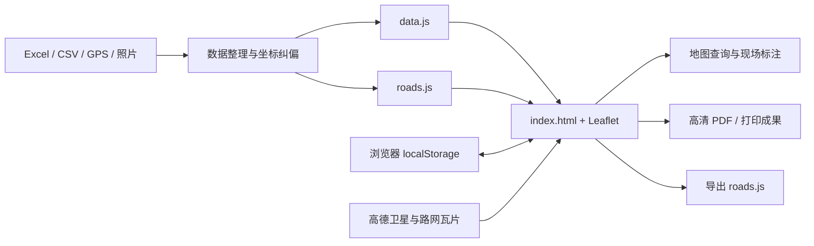

# 何桥村乡村路灯与闲置房屋测绘标注系统——项目说明

> 适用版本：039（本记录所在提交，实际哈希以 `git log` 为准）
> 更新日期：2026-07-28
> 面向对象：项目负责人、使用者、维护者和后续开发 Agent

## 1. 一句话说明

这是一个以何桥村卫星图为底图，把闲置房屋、出租状态、照片、道路、路灯和测量地块
集中到同一张地图上，并支持现场定位、GPS 记录、面积/长度计算和高清打印的
“零安装”村级测绘标注网页。

## 2. 当前想实现的效果

### 2.1 日常查看

- 双击网页即可看到何桥村卫星图和全部标记。
- 左侧列表可搜索房屋、房主、地址、备注和道路。
- 点房屋查看照片、租金、面积、附带农田/小院等信息。
- 用绿色/灰色房屋和“已租”角标直观看出租状态。

### 2.2 现场采集

- 手机显示实时 GPS 蓝点，帮助现场找到目标房屋。
- 沿道路行走即可自动记录轨迹、测算长度并保存为道路。
- 在卫星图上手绘看不清或尚未记录的道路。
- 沿地块边界逐点圈选，自动计算平方米、亩和公顷。

### 2.3 村级成果

- 汇总不同路面类型的长度、亮化路段和路灯盏数。
- 把道路、路灯、房屋、已租和地块面积一并打印。
- 输出日常 A4/A3、高清 A3/A1/A0、全村 A0/A1 和 4 页 A3 拼图。
- 将网页文件夹、道路文件、Excel 和成果图交给后续人员继续维护。

## 3. 系统架构



### 3.1 展示层

- `04_网页程序/index.html` 包含页面结构、样式和主要业务逻辑。
- `04_网页程序/lib/leaflet.js`、`leaflet.css` 为本地地图引擎，不依赖在线 CDN。
- 高德影像和路网注记仍需联网加载。

### 3.2 数据层

| 数据 | 权威来源 | 网页运行形式 | 更新方式 |
| --- | --- | --- | --- |
| 房屋与路灯点位 | `02_闲置房屋信息汇总表.xlsx`、点位 CSV | `data.js` | 用“数据更新工具”重新生成 |
| 道路 | 手绘、GPS、`roads.js` | `roads.js` + 当前村 localStorage | 网页导出/选择载入 |
| 已租标记 | 浏览器操作 | localStorage | 点房屋弹窗切换 |
| 面积地块 | 浏览器圈选 | localStorage + 独立 JSON 备份 | 测面积工具新增/删除/导出/选择载入 |
| 房屋照片 | `photos/编号/` 或原始照片归档 | 本地图片文件 | 按命名规则放置 |
| 成品图 | 网页打印 | PDF/PNG | 浏览器另存为 PDF |

### 3.3 浏览器状态

当前使用以下按村名隔离的本机存档；页面只精确读取当前村键，不会自动串读其他村的道路：

- `rentedMark_何桥村`：已租标记。
- `roadData_何桥村`：本机道路。
- `areaData_何桥村`：面积地块。
- `houseIconSize_何桥村`：图标大小。

这些数据不会自动跨电脑同步。面积地块可通过 `area-data.js` 生成和安全解析独立 JSON
备份，手动选择后整体覆盖当前村地块；页面不自动读取同级面积文件。`roads.js` 与当前村 localStorage 道路工作副本都保存
`lamped`/`lamps`；道路文件由 `road-data.js` 作为数据边界进行规范化、安全解析和摘要。
文件选择导入只解析 JSON 数据，不执行所选文件中的脚本。道路 ID 拒绝对象原型保留名；
道路索引使用无原型对象。导入先完成全量校验与图层预构建，再以 localStorage 写入作为
提交门槛；持久化或界面刷新失败都会保留/恢复原道路。其他浏览器状态仍需后续补强。

### 3.4 打印层

普通打印直接打印当前 Leaflet 地图。高清打印不依赖截图，而是：

1. 根据纸张毫米尺寸和比例尺计算地图范围。
2. 请求 17/18 级原生卫星瓦片。
3. 用 SVG/HTML 重新绘制道路、房屋编号、路灯和面积标签。
4. 使用 `@page` 生成真实 A3/A1/A0 页面。

因此底图清晰度和标注锐度高于屏幕截图。

## 4. 目录说明

| 路径 | 作用 |
| --- | --- |
| `04_网页程序/` | 主要交付程序 |
| `04_网页程序/index.html` | 网页主体与全部核心逻辑 |
| `04_网页程序/data.js` | 房屋/路灯运行数据，不应随意手改 |
| `04_网页程序/road-data.js` | 道路文件的数据边界：规范化、安全 JSON 解析、摘要与序列化 |
| `04_网页程序/area-data.js` | 面积地块 JSON 备份的数据边界：校验、面积摘要与序列化 |
| `04_网页程序/roads.js` | 可迁移的默认道路数据（含 `lamped`/`lamps`） |
| `04_网页程序/数据更新工具.html` | Excel 粘贴生成 `data.js` |
| `04_网页程序/使用说明.txt` | 面向现场和普通使用者的操作说明 |
| `02_闲置房屋信息汇总表.xlsx` | 房屋信息业务源头 |
| `点位及信息/`、`数据/` | 原始点位、纠偏结果和技术记录 |
| `图片/`、`04_网页程序/photos/` | 入户照片，涉及隐私，不进入 Git |
| `05_成品图/` | PDF/PNG 等交付成果 |
| `项目日志.md` | 每次版本变更记录 |
| `对话交接记录.md` | 不同 Agent/对话之间的上下文交接 |
| `乡村路灯与闲置房屋测绘标注系统_项目文档*.docx` | 早期历史文档，仅供追溯；当前状态以本套 Markdown 文档为准 |

## 5. 核心功能模块

### 5.1 房屋模块

- 房屋图标、编号标签、已租状态和隐藏筛选。
- 详情弹窗、照片自动发现、全屏照片浏览。
- 房屋搜索、列表定位、统计。
- `publicMode` 控制姓名和电话是否脱敏。

### 5.2 道路与路灯模块

- 泥路、水泥路、柏油路等样式。
- 路灯作为可叠加属性，以黄色虚线表现。
- 手绘道路、GPS 自动记录、长度计算。
- 道路名称、粗细、路面、路灯盏数编辑。
- 拖点、插点、延长、减短、拟合修顺和撤销。
- `roads.js` 导出与载入。

### 5.3 面积模块

- 多边形逐点圈选和实时预览。
- 球面面积计算。
- 平方米、亩、公顷显示。
- 名称、颜色、标签、删除、清空和打印。
- 独立 JSON 导出和手动选择载入；确认后整体覆盖当前村地块。

### 5.4 打印模块

- 快速打印当前画面。
- 18 级高清 A3/A1/A0 当前画面。
- 17 级全村 A0 1:5000、A1 1:6000。
- 18 级何桥村 A3×4，自动全村取景，约 1:6000。

## 6. 数据流

### 6.1 房屋数据

```text
走访/点位记录
  → Excel 汇总
  → 数据更新工具
  → data.js
  → 网页展示
```

`data.js` 是生成物，原则上应修改 Excel 源数据后重新生成，而不是长期直接手改。

### 6.2 道路数据

```text
网页手绘或手机 GPS
  → localStorage
  → 导出 roads.js
  → 【📂 选择道路文件】选择任意文件名
  → 核对摘要后确认覆盖当前村道路
```

浏览器已有本机道路时会优先使用当前村版本；跨电脑或换村时先导出备份，再主动点
【📂 选择道路文件】直接选择道路文件，核对摘要后确认覆盖。只有维护人员要把文件设为
项目默认道路时，才改名为 `roads.js` 并放在 `index.html` 同级。选择文件安全解析 JSON，
不会执行文件中的 JavaScript；取消、读取失败或校验失败均不改动现有道路。

### 6.3 照片数据

```text
原始照片归档
  → 按房屋编号建文件夹
  → 编号_1.jpg、编号_2.jpg……
  → 网页自动发现
```

照片和房主信息属于敏感资料，不能当作普通公开静态站点随意发布。

## 7. 坐标与精度

- 地图内部统一使用 GCJ-02（高德坐标）。
- 第四记/高德地图上直接打的点一般已经是 GCJ-02。
- 手机 GPS 通常是 WGS84，进入高德底图前必须纠偏。
- 百度 BD-09 不可直接使用。
- 房屋和 GPS 点位精度约 5～15 米，仅适合村级调查和示意。
- 圈地面积取决于边界点是否点准，不属于法定地籍测量。

## 8. 运行与依赖边界

### 8.1 可以离线的部分

- 网页程序、Leaflet、房屋/道路数据和本地照片。
- 列表、搜索、状态管理、道路/面积计算。

### 8.2 必须联网的部分

- 高德卫星影像和路网瓦片。
- 高清打印时的大量瓦片加载。

### 8.3 浏览器限制

- 数据主要保存在当前设备、当前浏览器的 localStorage。
- 清除浏览器数据会导致未导出的状态丢失。
- GPS 权限受浏览器安全策略限制，局域网 HTTP 打开时可能无法定位。
- A3 四页高清打印约加载 2100 张瓦片，建议使用电脑。

## 9. 隐私与发布

- 内部使用：`publicMode: false`，显示房主姓名和电话。
- 对外展示：必须改为 `publicMode: true` 并检查照片和成品图；对外拷贝的 `data.js` 应由
  数据更新工具勾选“对外展示模式”重新生成，此时姓名、电话不写入文件（044 起）。
- 开源版本：GitHub 公开仓库使用虚构示例房屋数据、无照片、无 Git 历史，由脱敏导出脚本生成（044）。
- `图片/` 和 `04_网页程序/photos/` 已忽略，不应提交 Git。
- 老 Git 历史曾包含部分照片；若仓库需要公开，必须另行授权后清理历史。
- 公开网页前还应确认高德影像和个人信息使用边界。

## 10. 当前状态

- 房屋：82 处。
- 路灯独立点位：0。
- 道路：51 条，51 条亮化、48 条正数、沿路路灯 597 盏。
- 标记范围：约东西 3.69 公里、南北 3.01 公里。
- 当前稳定版本：039。
- 当前阶段：可用原型完成，进入数据补全、备份能力和正式交付治理阶段。

## 11. 已知限制

1. 没有后端、账号和多人同步。
2. 已租标记尚无标准导出文件；面积地块已有独立 JSON 迁移文件。
3. `index.html` 超过 10 万字节，后续维护复杂度开始升高。
4. 对第三方在线瓦片服务存在依赖。
5. 房屋业务数据与网页生成物之间仍依赖人工操作。
6. 已有固定 Node 原生测试覆盖道路/面积数据边界、标准数据一致性、数据更新工具，以及
   Edge 中的道路/面积文件导入、持久化、回滚、刷新、`file://` 双击打开和三档实际打印流程；
   尚未建立持续集成服务。

## 12. 文档导航

- 快速入口：`README.md`
- 正式立项：`项目立项文档.md`
- 后续路线：`开发计划.md`
- Agent 规则：`Agent宪法.md`
- 版本变化：`项目日志.md`
- 跨对话接手：`对话交接记录.md`
- 普通操作：`04_网页程序/使用说明.txt`
